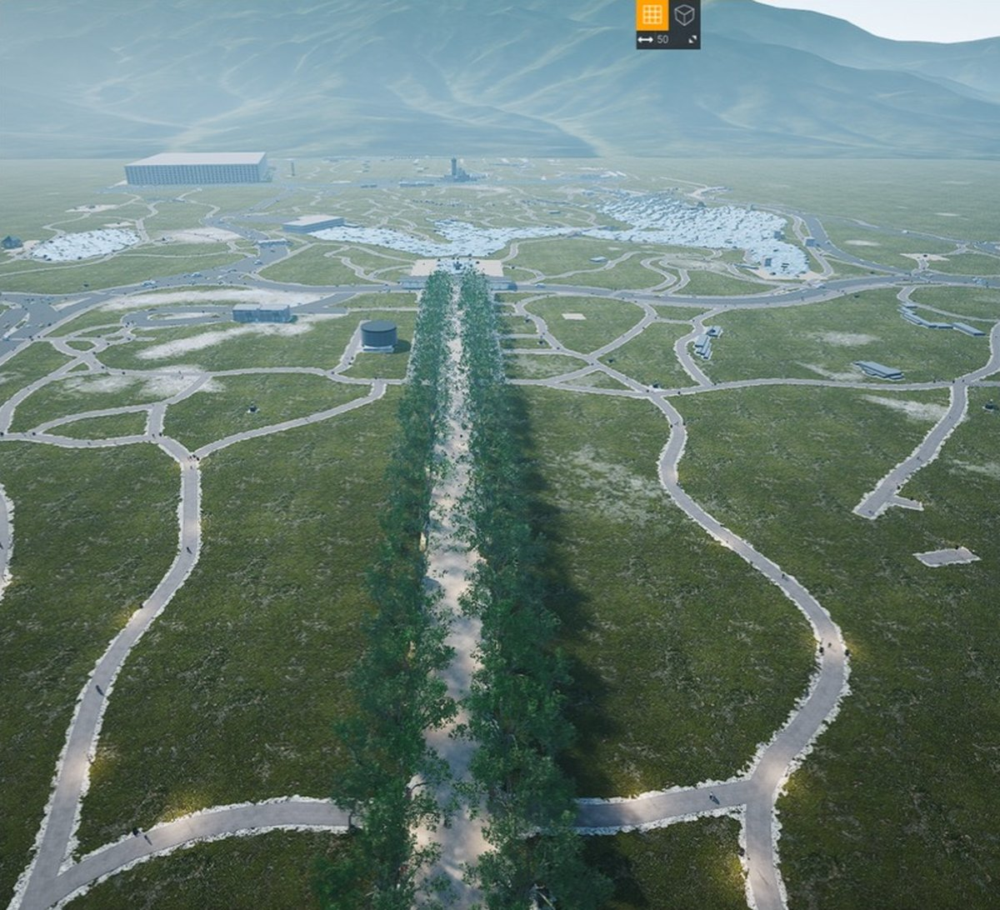
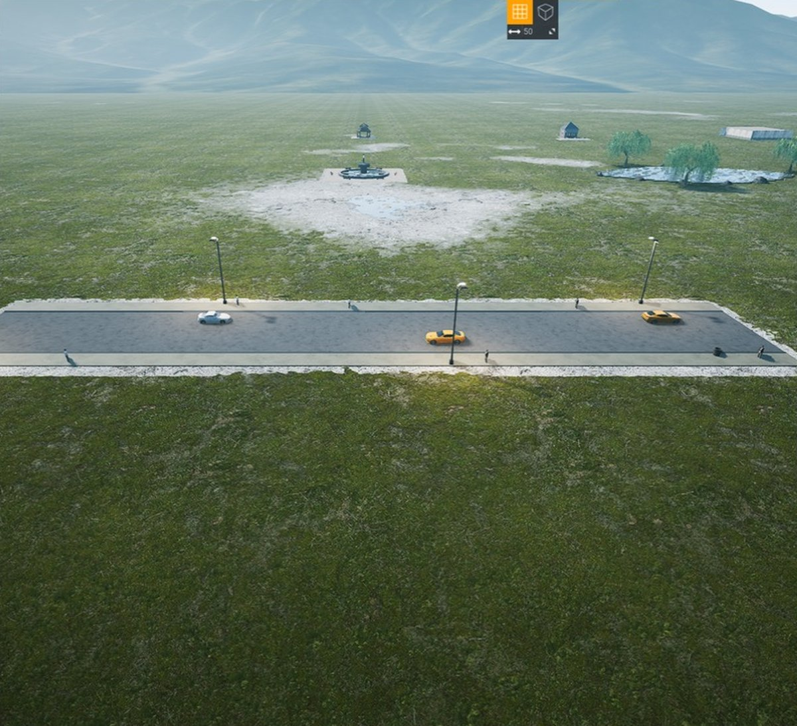
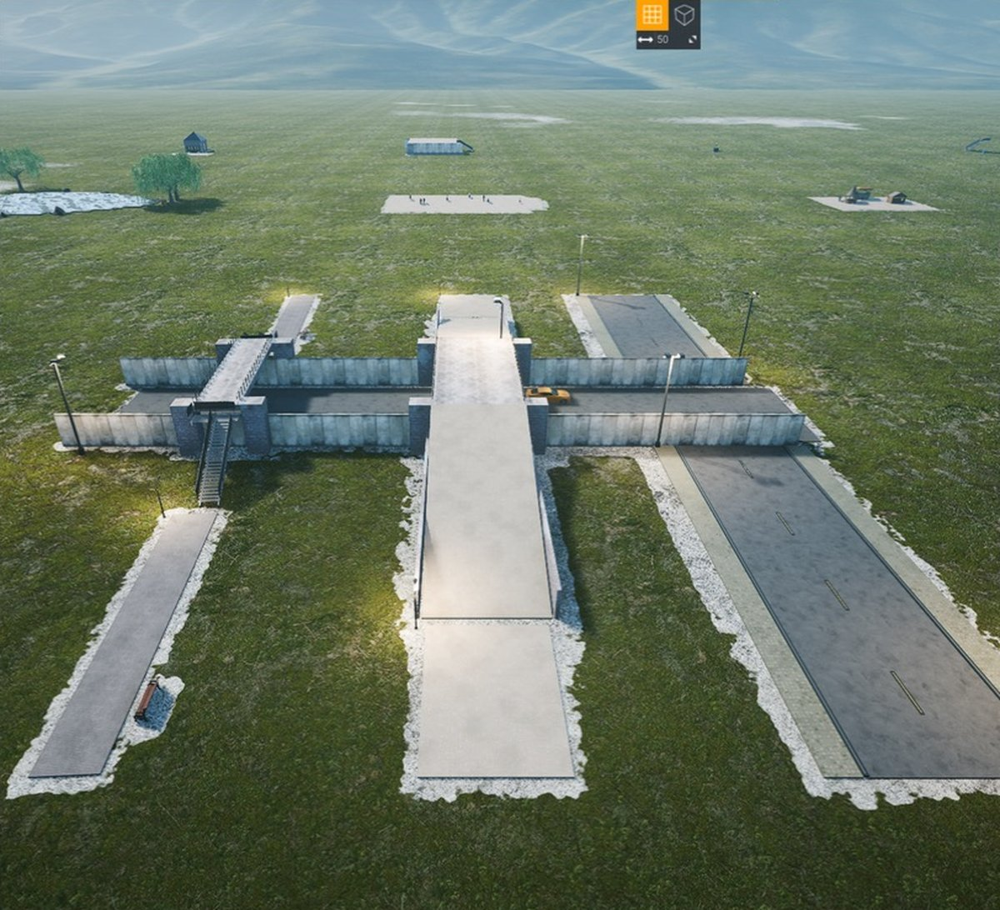
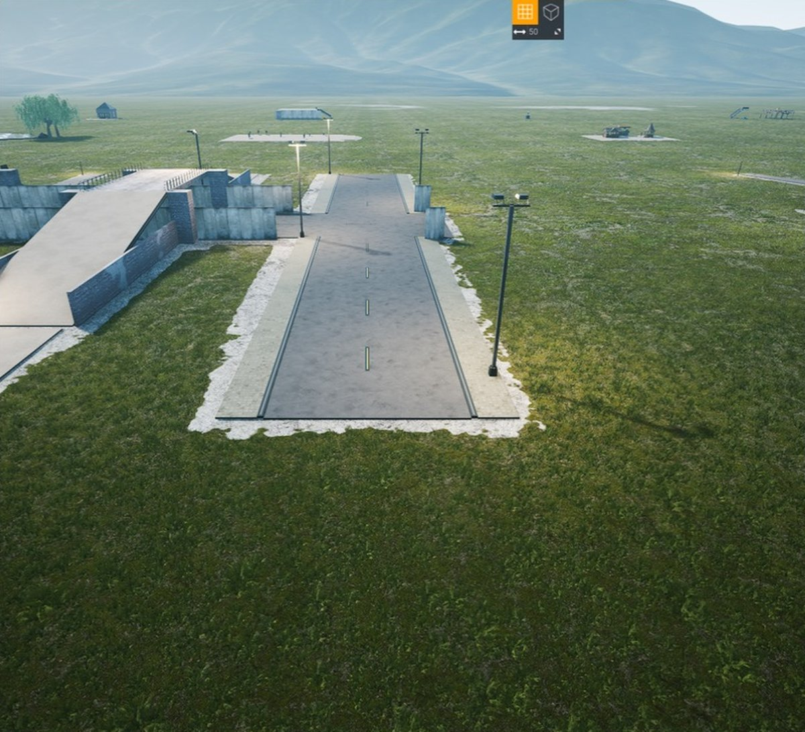
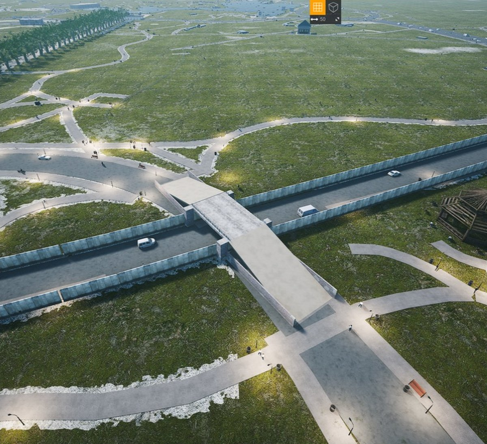

# Uncrashed map tooling

Custom maps for **Uncrashed: FPV Drone Simulator** (Steam app 1682970, Unreal Engine 4.27), generated from
real-world map data by a library of verified parts instead of hand placement in the in-game editor.



Three maps live here:

| map | in-game name | base level | state |
|-----|--------------|------------|-------|
| `maps/NYC` | New York City - Midtown Manhattan | Empty board | published on the Workshop; first-generation builder |
| `maps/CentralPark` | New York City - Central Park | BaseLandscape02 (real grass) | being rebuilt on the parts library |
| `maps/FPVPark`, `maps/FPVParkRookie` | FPV Airspace Park (+ Rookie race) | Mountain | not published yet |

Everything measured about the game (file format, pivots, gate conventions, heightmaps, decals) is written down
here and in the tool docstrings. Nothing in this repository was guessed from screenshots alone: every rule was
read from the game files or from player-built Workshop maps, then checked in the game.

## Contents

1. [Playing a map](#playing-a-map)
2. [The parts library](#the-parts-library)
3. [Verifying in the game](#verifying-in-the-game)
4. [The maps](#the-maps)
5. [Data pipeline](#data-pipeline)
6. [Map file format](#map-file-format-reverse-engineered)
7. [Tools](#tools)
8. [Code style and repository hygiene](#code-style-and-repository-hygiene)

## Playing a map

Each builder installs its map straight into the game's local map folder:

```
~/Library/Application Support/Uncrashed/<SteamID64>/MapEditor/User/<Name>/
    <Name>.json     the map
    <Name>.info     name, base level, creator, timestamp
    Thumbnail.jpg   top-down render
    Decals/         generated PNG decals (window grids, billboards), if the map has any
```

Open Uncrashed, go to the Track Editor, and load the map from your local maps. The Steam ID comes from the
`UNCRASHED_STEAM_ID` environment variable.

**Steam Cloud.** The game syncs this folder to Steam Cloud (`steam_autocloud.vdf`). Deleting a map folder on disk
is not enough: Steam restores it on the next launch. Delete the map inside the game, or on Steam's Remote Storage
page for the app (`https://store.steampowered.com/account/remotestorageapp/?appid=1682970`), then on disk.

**Publishing.** Title and description live only on Steam. `maps/<Name>/workshop.json` keeps them beside the map
and `tools/publish.py` renders the `steamcmd workshop_build_item` script from it (not yet exercised end to end).

## The parts library

Maps are stitched from **parts**. A part that passed the tests and the showroom renders identically in every
map because everything, maps included, is built into the same `Scene`.



*The `road` part: carriageway, lane dashes, kerbs, a sidewalk each side, tall lamps alternating sides, bins,
walkers on the sidewalks only, cars in both lanes heading with their lane.*

| file | role |
|------|------|
| `tools/scene.py` | the one object a map is built into: base level and ground sampler, instance store, occupancy grid (path / road / sidewalk / water / building / bridge), keep-clear zones, the `add` / `place` / `box` / `plane` / `put` primitives, the writer (`maps/<Name>/` plus the game folder) and the checks (floating, buried, off-landscape, take-off clearance) |
| `tools/mapkit.py` | asset-first recipes bound to a scene: surfaces on per-material height bands, walls and fences from panels, oriented benches, kiosks, vehicles aligned from the catalogue, stairs, bridges, basins, mesh-first buildings. `place()` positions a mesh by its bounding box, because several meshes have corner or end pivots |
| `tools/prefabs.py` | the parts: `road`, `path`, `road_cut`, `footbridge`, `pond`, `fountain`, `plaza`, `kiosks`, `playground`, `gazebo`, `cafe`, `terrace`, `statue`, each with a demo in `DEMOS` |
| `tools/showroom.py` | lays every demo on a grid in a ~700-object map that loads in seconds and prints a `tools/setcam.py` line per demo |
| `tools/test_prefabs.py` | builds every demo on a flat scene and checks it by geometry, plus a golden hash per demo in `data/prefab_golden.json` |
| `tools/setcam.py` | `setcam <Map> x y z yaw pitch` points a map's editor camera for in-game screenshots |

### The rule for changing or adding a part

1. Write or change the part in `prefabs.py`, with a demo.
2. `python3 tools/test_prefabs.py` must pass. It checks the written form of every bug that was once seen in the
   game: cars entirely inside asphalt, walkers / lamps / benches / bins never on a carriageway, no wall panel on
   a carriageway, stair landings meeting a deck, water inside the basin ring, nothing floating, buried or
   outside the demo's footprint, traffic in both directions.
3. `python3 tools/showroom.py`, open **Prefab Showroom** in the track editor, look at the demo from the printed
   camera line.
4. `python3 tools/test_prefabs.py --update` accepts the new golden hash. Only now may a map builder call it.

### What the parts encode



*The `road_cut` part: a sunken road stand-in (the terrain cannot be dug) with a footpath bridge on stairs, a wide
promenade bridge on ramps, and a drive crossing at grade.*

- **Vehicles.** The long axis comes from the catalogue bounds (the van is long on Y, the cars on X). A vehicle is
  refused anywhere the occupancy grid is not carriageway. Lanes alternate so traffic runs both ways.
- **Bridges are straight.** A bridge's axis is the chord of the path it carries, measured between the two points
  where the path is cut back; the deck spans just the cut; stairs (paths under 6 m) or ramps (wider ways) land
  exactly where the path was cut, with short straight links where the path bends; nothing else stands on the
  bridge footprint. Bridges closer than 14 m merge, widest wins.
- **Road cuts.** The carriageway is never cut and runs under every bridge. Where a drive crosses at grade the
  walls break: the gap circle's radius is the hypotenuse of the half-gap and the wall offset, because a circle of
  the half-gap alone never reached walls 6.8 m off the centreline. Lamps stand on the bank outside the walls.



- **Fountains.** A solid masonry ring (concrete segments, not a thin brick wall, which read as a rail from the
  air) with 2 m water tiles that stop 1.6 m short of the ring, 0.25 m below the rim; benches round it facing
  the water; the basin is a keep-clear zone.
- **Ponds.** Water tiles subdivided to 2 m at the shore, 0.30 m above the highest ground inside (on
  BaseLandscape02 the decoded heightmap sits 0.30 m under the rendered surface, measured from Workshop maps);
  bank rocks and willows just outside the shore.
- **Benches** run along their path with the seat facing it: yaw = path yaw − side·π/2 (long axis is the mesh's
  local Y, the seat local +X).
- **Surfaces** sit on height bands (lawn 0, dirt .05, gravel .07, asphalt .10, pavement .14, flagstone .16, wood
  .18, plaza .20, sidewalk .22 m) and consecutive pieces of one path alternate by 4 mm so overlaps never z-fight.
- **Mesh pivots are not always centred.** `SM_Stair_A` has its pivot at one side of the foot (bbox X 0..3.58 m,
  Y −3.6..+5.0 m, Z −0.37..+5.3 m) and climbs toward its local +Y; `SM_Deck_Floor_04` has it at a corner. Placing
  such pivots at a bridge centre put the meshes metres off, so `place()` uses the catalogue bounds.
- **Take-off clearance.** Nothing but the ground within 1 m of the spawn capsule (0.2 to 2.2 m up); the build
  aborts otherwise.

## Verifying in the game

Uncrashed is a cooked game: its maps cannot be opened in the Unreal editor, so verification happens in the game's
own track editor, driven from the command line and a screenshot:

1. Build the map (`--editor` on the Central Park builder drops the trees and the city so the editor loads in
   about a minute instead of ten).
2. `python3 tools/setcam.py <Map> x y z yaw pitch` writes the editor camera into the map (yaw −90 looks along −Y,
   negative pitch looks down).
3. Relaunch the game through Steam (`open steam://rungameid/1682970`), open the Track Editor, click the map tile
   (the list is sorted by build time, newest first), screenshot.



*Central Park, the 65th Street transverse under Center Drive: carriageway continuous under the deck, piers at the
walls, ramps on the axis, cars along their lanes, no walkers in the trench.*

## The maps

### Central Park

`python3 tools/build_centralpark.py [--editor|--no-trees|--no-city|--lite|--no-windows]` builds **CentralPark**
from OpenStreetMap on **BaseLandscape02**: the only base with real grass (the Empty board is a numbered grid and
the grass blueprint renders grey on a Mac), flat to within 2 m, matching the 2.2 km flight box. The landscape is
not centred on the origin (−1209..+806 m on both axes, measured from its heightmap), so the frame
(`data/centralpark_frame.json`) puts the origin on Bethesda's lower terrace with nothing within 5 m: the spawn
looks north at the Angel fountain and the Lake. The map covers the park from Central Park South to the Great Lawn
plus Midtown to about 56th Street.

What is in it: water with island holes and rocky banks, streams, the Mall's elm rows, Bethesda Terrace with
arcade, stairs and fountain, Belvedere on Vista Rock, the Obelisk, Bow Bridge, the Carousel, Delacorte, the
Bandshell, Tavern on the Green, Cherry Hill, ballfields, tennis courts, the Sheep Meadow fence, about 10,000 trees
(half at mapped positions by genus), lamps and benches on every path, vendors at every gate, boats, crowds,
traffic and lamps on the framing streets, Columbus Circle, Grand Army Plaza and the Imagine mosaic as a decal.
The transverse roads are walled cuts with at-grade junctions for drives and straight footbridges for paths, as
in the showroom above. The builder is being moved onto the parts library feature by feature; the full build is
about 44,000 instances, the editor build about 26,000.

OSM data © OpenStreetMap contributors, ODbL. Reference imagery `data/centralpark_naip.png` is USGS NAIP.

### NYC (Midtown Manhattan)

`python3 tools/build_nyc.py` builds the first map: the 2 km flyable square centred on 5th Avenue and 38th Street
(28th to 48th Street, 8th to 2nd Avenue) from NYC Open Data building footprints with real roof heights and the
street centreline file with real widths. About 92,000 placed assets plus 2,300 window and billboard decals.

How it is built (first-generation code, predating the parts library):

- Freestyle maps ignore `Race.StartTransform`; the drone spawns at the base level's PlayerStart, on the Empty
  board the origin facing −Y. The frame is rotated 44° so −Y points at the Empire State Building 380 m away.
- Building footprints become one rectangle when the minimum-area rectangle covers 74 % of the polygon, otherwise
  up to twelve rectangles from a raster split, snapped to the Manhattan grid when within 18 % of the minimum
  rectangle. Rectangles up to 60 m are tiled with the editor's textured building meshes when a grid fits within
  30 % scaling; the rest are boxes with materials by age and height (brick, concrete-as-limestone, grey, glass),
  1916-zoning setbacks on pre-war towers, water towers, bulkheads and parapets on roofs; the Empire State,
  Chrysler and One Vanderbilt are hand-massed.
- Streets at their recorded widths with raised sidewalks measured per side, lane lines, crosswalks, elms and
  maples, floodlights and lamps, taxis and vans, pedestrians, carts, benches, planters, scaffolding sheds.
- Void filling turns leftover patches into rear yards, parking lots or plazas; parks come from the NYC Parks
  dataset with Bryant Park laid out by hand; Times Square and Herald Square are pedestrian plazas with LED
  screens, neon and the TKTS steps.
- FPV features: construction sites with open concrete skeletons and cranes, open parking decks, skybridges, and
  the Park Avenue viaduct around Grand Central from the centreline file's elevated level codes.
- Window decals on every plain facade over 30 m and billboard decals around Times Square, projected with the
  decal basis that matches editor-placed decals exactly: X into the surface, Y straight down, Z = X × Y along
  the wall; scale X = depth, Y = height / 4, Z = width / 4. PNGs go to `MapEditor/UserDecals/` and
  `MapEditor/MapDecals/`, where the editor loads user decals from.
- The whole 6 km board is used, with full detail in the central 2 km and thinner rings outside.

### FPV Airspace Park (not published yet)

`python3 tools/build_fpvpark.py [--rookie]` builds a designed freestyle and race park on the Mountain landscape:
a road loop reserved first as the spine, a central arena of chained freestyle features (dive spire, bando with a
gauntlet wing, power-loop goalposts, bridge, gap panels, tunnel, container stacks, tree tunnel, orbit tower,
towers with dive ledges) and five themed districts, dressed with props, forest belts and FPV Airspace billboards.
Every feature registers its flight gap as a tube; props inside a tube are deleted and a structure in a strict
tube aborts the build.

**Race storage, measured on 17 Workshop tracks:** start and gate yaw = flight bearing − 90° (local +Y is the
flight direction); gate 1 lies on the start's local +Y; no STARTGATE checkpoint row, the in-game start actor
(`BP_StartRace`: a Gate2 mesh plus `GateStart2`) comes from `StartTransform`; respawn 0 is placed 12 m behind
the start facing it; checkpoint `Scale3D` is honoured, and Workshop tracks scale the 2 m gates up to 5.5×; gate
opening = pivot + detection-box offset × scale (`data/gate_bounds.json`). `tools/raceline.py` checks every leg
(start → gate 1 → … → start) as a straight segment against every mesh's oriented bounds and the terrain; the
build aborts if a leg is blocked at a 1.5 m tube. The rookie variant is a 20-gate race of big low inflatables
round the road loop. Race plans: `maps/FPVPark/race_plan.png`, `maps/FPVParkRookie/race_plan.png`.

## Data pipeline

- **Game data.** `tools/pakread.py` lists the game's `.pak` files (version 11, unencrypted, Zlib),
  `tools/pakextract.py` extracts by substring, `tools/uasset.py` reads cooked UE4.27 assets (names, imports,
  exports, properties, DataTable rows), `tools/build_catalog.py` dumps `DT_MapEditorAssets` with each mesh's
  bounds into `data/catalog.json` (804 rows), `tools/bounds_fix.py` completes it for basic shapes and blueprint
  rows, `tools/build_index.py` and `tools/assets.py` build the searchable asset index (`docs/ASSETS.md`).
  Extracted game files stay out of git.
- **Landscapes.** `tools/landscape.py` decodes a base level's landscape heightmap textures. Validated: the
  sampler returns exactly −15.00 m at the Mountain level's PlayerStart and matches ground objects of six Workshop
  maps within 0.1 m; BaseLandscape02 renders 0.30 m above its decoded heightmap (`SURFACE_OFFSET_CM`).
- **Real places.** `tools/osm.py` turns an Overpass dump into classified lines and polygons in a local metre
  frame (`Frame(lat0, lon0, axis_deg, flip_north)`); the Overpass `out body; >; out skel qt;` form lists ways
  twice and the loader keeps the tagged copy. NYC uses the city's open data (buildings `5zhs-2jue`, parks
  `enfh-gkve`, land `63ge-mke6`, streets `inkn-q76z`), queried with `intersects(the_geom, POLYGON(...))`.
- **Checks.** `tools/mapcheck.py` (floating, buried, off-landscape, take-off clearance), `tools/raceline.py`
  (race legs), `tools/racemap.py` (race plan drawing), `tools/preview.py` and `tools/topdown.py` (renders without
  the game).

## Map file format (reverse engineered)

A map is a folder containing `<Name>.json`, `<Name>.info` and `Thumbnail.jpg`. Workshop downloads add
`Steam.wrk` and an optional `Decals/` folder. The JSON has these top-level keys:

| key | content |
|-----|---------|
| `S_AssetsTransform` | list of `{Rname, Transform[], UniqueGroupTag[]}`; one entry per asset row, one transform per instance, tags are `"None"` |
| `BaseMapRow` | row name in `DT_LevelName` (`BaseBoard`, `BaseLandscape`, `BaseLandscape02..04`, `MountainOpen`, `DriftTrack`, ...) |
| `WeatherIndex` | integer weather preset |
| `Race` | `CheckPoints[]`, `StartTransform`, `Laps`, `BestTime`, `Spoints[]` |
| `CamLoc` | editor camera transform |
| `CustomWeather` | `timeOfDay`, `northyaw`, `Cloud` (optional) |

Transforms are `{Rotation: quaternion XYZW, Translation: cm, Scale3D}`; the translation is the actor pivot, so a
cube is placed by its centre, the brick wall by its base and the concrete floor by its top. `Rname` values are
rows of the game's `DT_MapEditorAssets` DataTable:

| row | mesh | base size | pivot |
|-----|------|-----------|-------|
| `NewRow_13` / `_46` yellow / `_79` blue / `_84` red / `_268` green / `_256` grey / `_378` violet / `_109` black | `SM_Cube` | 1 × 1 × 1 m | centre |
| `NewRow_14` / `_64` / `_81` / `_89` / `_272` / `_261` grey / `_380` / `_113` black | `SM_Cylinder` | 1 m diameter, 1 m tall | centre |
| `NewRow_303` | `SM_ConcreteFloor01`, triplanar concrete | 4 × 4 × 0.30 m | top (z from −0.29 to +0.01) |
| `NewRow_318` | `SM_ConcreteWall01`, triplanar brick | 0.3 × 4 × 4 m | bottom centre |
| `NewRow_182` / `_185` / `_197` / `_186` / `_376` / `_180` / `_181` / `_662` / `_184` | `SM_BaseGround` asphalt / pavement ×3 / flagstone / dirt / gravel / sand / wood | 4 × 4 × 0.1 m | centre |
| `NewRow_183` | `BP_meWater_C` | 4 × 4 × 2.1 m | water surface |

The `.info` file holds only `Name`, `BaseMapRow`, `CreatorSteamID`, `CreationTimeUnix` and `Track`.

## Tools

| script | purpose |
|--------|---------|
| `tools/scene.py`, `tools/mapkit.py`, `tools/prefabs.py` | the parts library (scene, recipes, parts) |
| `tools/showroom.py`, `tools/test_prefabs.py`, `tools/setcam.py` | showroom map, geometry tests, editor camera |
| `tools/build_centralpark.py`, `tools/build_nyc.py`, `tools/build_fpvpark.py` | the map builders |
| `tools/osm.py`, `tools/landscape.py`, `tools/geom.py` | OpenStreetMap extraction, heightmaps, geometry helpers |
| `tools/mapcheck.py`, `tools/raceline.py`, `tools/racemap.py`, `tools/preview.py`, `tools/topdown.py` | checks and renders |
| `tools/pakread.py`, `tools/pakextract.py`, `tools/uasset.py`, `tools/build_catalog.py`, `tools/bounds_fix.py`, `tools/build_index.py`, `tools/assets.py`, `tools/thumbs.py` | game-data extraction and the asset catalogue |
| `tools/publish.py` | Workshop publishing script from `maps/<Name>/workshop.json` |

## Code style and repository hygiene

The tools are formatted with [ruff](https://docs.astral.sh/ruff/) (`python3 -m ruff format tools`, settings in
`pyproject.toml`, 120 columns) and every tool is documented in its docstrings. Run `python3 tools/test_prefabs.py`
before committing a change to the parts library.

This repository is public. Extracted game assets, pak listings, raw map dumps and thumbnails are ignored by git;
everything committed under `data/` is public data or metadata derived from the game. The Steam ID is read from
`UNCRASHED_STEAM_ID`.
